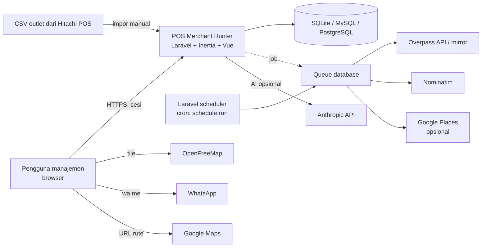
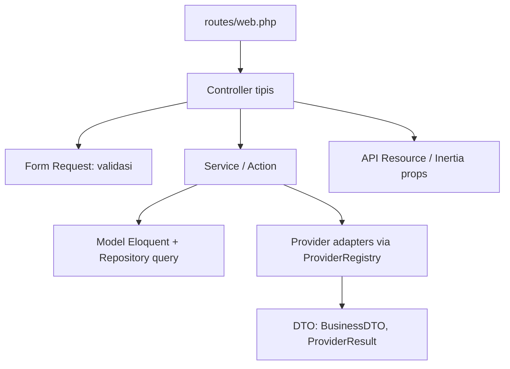
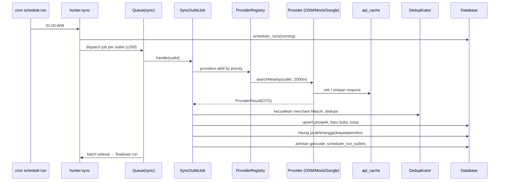
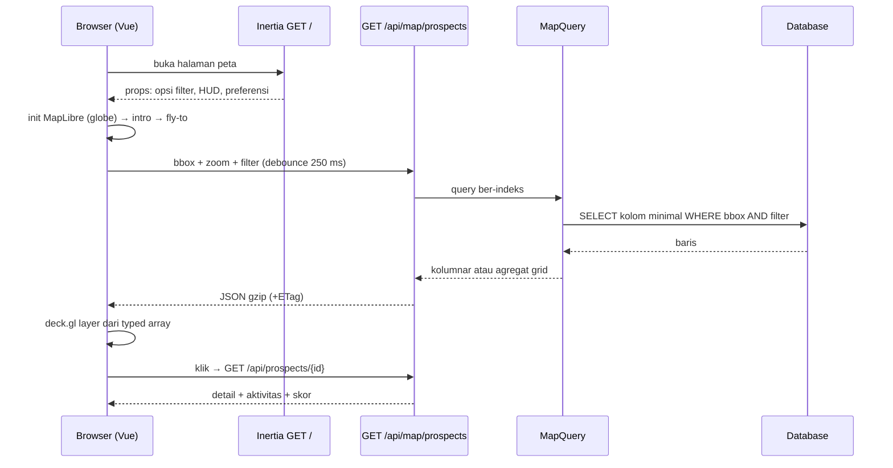

# ARCHITECTURE — POS Merchant Hunter

## 1. Konteks Sistem



Panggilan eksternal data hanya dari queue/scheduler. Browser langsung hanya ke tile basemap. Dua pengecualian dari request pengguna (D-60): "Uji koneksi" Data Source dan "Buat pesan dengan AI", keduanya dengan rate limit dan timeout.

## 2. Layer Backend



Prinsip: controller hanya validasi → panggil Service/Action → kembalikan Resource/Inertia. Logika bisnis di `app/Services` dan `app/Actions`. DTO untuk data provider. Query kompleks (peta, white space, dashboard) di `app/Repositories`.

### Struktur `app/`

```
app/
  Actions/                 # satu aksi per kelas: ContactProspectAction, ChangeStatusAction, OptOutAction, ImportOutletsAction
  Console/Commands/        # hunter:*
  DTO/                     # BusinessDTO, OutletPoint, ProviderResult, ScoreInput, ContactCheck
  Enums/                   # PipelineStatus, LifecycleStatus, GeocodeStatus, ActivityType, ScoreBand
  Http/
    Controllers/           # Auth, Map, Prospect, Pipeline, Route, Dashboard, Impact, Master/*, SchedulerRun
    Requests/              # Form Request
    Resources/             # ProspectResource, OutletResource, ...
    Middleware/            # HandleInertiaRequests, SecurityHeaders
  Jobs/                    # SyncOutletJob, FinalizeRunJob, GeocodeProspectJob, GeocodeOutletJob
  Models/
  Repositories/            # MapQuery, DashboardQuery, WhiteSpaceQuery, ProspectFilter
  Services/
    Providers/             # DataProvider, OsmProvider, MockProvider, GoogleProvider, ProviderRegistry
    Geo/                   # Haversine, BoundingBox, GridAggregator
    Scoring/               # ScoreCalculator
    Dedupe/                # NameNormalizer, Similarity, Deduplicator
    Sync/                  # SyncService, LifecycleDetector
    Geocoding/             # GeocoderInterface, NominatimGeocoder, AddressFormatter, MatchScorer
    Contact/               # WhatsAppNormalizer, MessageBuilder, ContactPolicy, AiMessageService
    Routing/               # RoutePlanner (NN + 2-opt), GoogleMapsUrlBuilder
    Impact/                # ImpactCalculator
    Export/                # CsvExporter
database/
  migrations/ seeders/ factories/
```

## 3. Alur Data Scheduler



## 4. Alur Permintaan Peta



## 5. Frontend

```
resources/js/
  app.ts                       # bootstrap Inertia
  Layouts/                     # AppShell (HUD mengambang, nav radial/dock)
  Components/
    ui/                        # GlassPanel, Button, Badge, Drawer, CommandPalette, Skeleton, EmptyState, ErrorState, Tooltip  ← FE-Design-System
    prospect/                  # ProspectCard, ScoreBreakdown, SimulasiBadge, WhatsAppButton ← FE-Pipeline
    charts/                    # KPI counter, funnel, kartogram         ← FE-Dashboard-Master
  Pages/
    Auth/Login.vue
    Map/Index.vue (+ Map/*)    # FE-Peta
    Pipeline/Index.vue         # FE-Pipeline
    Dashboard/Index.vue        # FE-Dashboard-Master
    Impact/Index.vue
    Master/DataSources.vue, Outlets.vue, Categories.vue
    Scheduler/Runs.vue
  map/                         # FE-Peta: createMap, intro, layers/*, useMapData, usePicking, basemap, fallbackStyle
  composables/                 # useFilters, useDebounce, useReducedMotion, useShortcuts, useTheme
  lib/                         # format, whatsapp, colors, api (axios), types
  types/                       # tipe sesuai CONTRACTS.md
tests/
  Unit/ Feature/ e2e/
```

Aturan kepemilikan file (agar subagent paralel tidak bentrok, D-68):
- **FE-Design-System** (selesai di Sesi 2): `Components/ui/*` (termasuk KPI counter), konfigurasi tema/CSS, `composables/*` (useTheme, useReducedMotion, useFilters, useDebounce, useShortcuts), **`Layouts/AppShell`** (HUD, dock navigasi), serta komponen bersama berbasis kontrak: `Components/prospect/*` (`ProspectCard`, `ScoreBreakdown`, `SimulasiBadge`, `WhatsAppButton`, `WhatsAppComposer`, `ProspectDrawer`, `FilterPanel`). Diuji dengan props contoh dari `CONTRACTS.md` (tanpa backend).
- **FE-Peta**: `Pages/Map*`, `map/*` (termasuk panel & layer perencana rute, `RoutePanel`).
- **FE-Pipeline**: `Pages/Pipeline*` (Kanban, tabel, bulk, aktivitas) memakai komponen bersama.
- **FE-Dashboard-Master**: `Pages/Dashboard*`, `Pages/Impact*`, `Pages/Master*` (termasuk `Master/Settings`), `Pages/Scheduler*`, `Components/charts/*`.
- **Orkestrator (5.0)**: `lib/`, `types/` (dari CONTRACTS.md); penambahan sesudahnya lewat orkestrator.

## 6. Konvensi Kode

- Bahasa: identifier, komentar, commit **Inggris**; teks UI dan dokumen Indonesia.
- PHP: PSR-12 via Laravel Pint; `declare(strict_types=1)`; enum untuk status; kelas `final` untuk service; tidak ada logika di controller/model selain scope & cast.
- Vue: `<script setup lang="ts">`, komponen ≤ ~250 baris (pecah dan ekstrak composable), props bertipe, tanpa `any` tanpa alasan, ESLint.
- Nama: `Prospect*`, `Outlet*`; REST bernama jamak; JSON snake_case, Inertia props snake_case (selaras DB).
- Objek peta: non-reaktif (D-14), selalu dibersihkan.
- Tidak ada panggilan eksternal dari request pengguna (kecuali dua pengecualian D-60).
- Test berdampingan dengan kode; commit kecil conventional.
