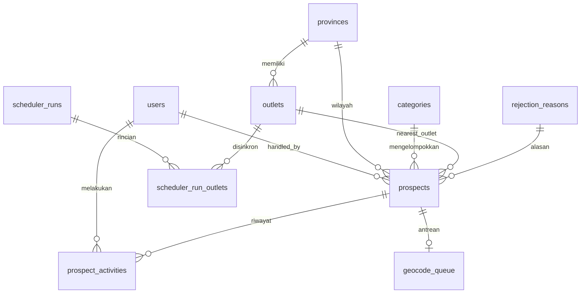

# DB-SCHEMA (BEKU)

Skema ini dibekukan di Sesi 1. Migrasi Fase 5.0 ditulis **verbatim** dari dokumen ini (satu migrasi per tabel, urutan sesuai bagian "Urutan migrasi"). Perubahan wajib dicatat di `DECISIONS.md`. Tipe ditulis netral (kompatibel SQLite/MySQL/PostgreSQL). Semua tabel memiliki `created_at`/`updated_at` kecuali dinyatakan lain. Waktu disimpan UTC; tampilan Asia/Jakarta.

## ERD

## Tabel

### users
| Kolom | Tipe | Catatan |
|---|---|---|
| id | bigint PK | |
| name | string(120) | |
| email | string(190) unique | |
| password | string | hash bcrypt |
| remember_token | string(100) null | |

### provinces (referensi, di-seed 38 baris)
| id | PK |
| code | string(8) unique | mis. `JK` |
| name | string(80) | |
| capital_city | string(80) | |
| lat, lng | decimal(9,6) | pusat kota provinsi |

### categories (master kategori target)
| id | PK |
| key | string(40) unique | `restaurant`, `cafe`, … |
| name | string(80) | |
| weight | unsignedTinyInteger | 0–100, bobot kecocokan skor |
| whatsapp_template | text | placeholder `{nama_bisnis}`, `{nama_pengirim}`, `{kategori}` |
| osm_filters | json | pasangan tag OSM |
| google_types | json null | `includedTypes` Places API untuk GoogleProvider |
| is_active | boolean default true | |
| sort_order | smallint | |

### data_sources
| id | PK |
| key | string(20) unique | `osm`, `mock`, `google` |
| name | string(80) | |
| is_active | boolean | |
| priority | smallint | angka kecil = prioritas tinggi |
| api_key | text null | cast `encrypted` |
| config | json null | endpoint, mirror, jeda, dll. |
| monthly_quota | integer null | |
| cost_search_per_1000 | decimal(8,4) null | USD, diisi pemilik (tarif pencarian) |
| cost_details_per_1000 | decimal(8,4) null | USD, diisi pemilik (tarif detail) |
| calls_this_month | integer default 0 | |
| last_run_at | timestamp null | |
| last_status | string(20) null | `ok`, `error`, `disabled` |
| last_error | text null | |

### outlets
| id | PK |
| code | string(20) unique | |
| name | string(160) | nama merchant dummy |
| address | string(255) null | |
| city | string(80) | |
| province_id | FK provinces | index |
| lat, lng | decimal(9,6) null | null saat menunggu geocode |
| place_id | string(255) null | |
| geocode_source | string(20) null | `seed`, `csv`, `nominatim`, `manual`, `google` |
| geocode_status | string(20) default `ok` | `ok`, `needs_review`, `failed`, `manual` |
| geocode_score | unsignedTinyInteger null | 0–100 |
| geocode_candidates | json null | kandidat untuk verifikasi manual |
| is_active | boolean default true | |
| is_simulated | boolean default true | data dummy |
| last_synced_at | timestamp null | |
| baseline_done_at | timestamp null | sync pertama (baseline "baru buka") |
Indeks: `(lat, lng)`, `province_id`, `is_active`, `last_synced_at`.

### prospects
| Kolom | Tipe | Catatan |
|---|---|---|
| id | bigint PK | |
| provider | string(20) | `osm`, `mock`, `google` |
| place_id | string(255) | `node/123` untuk OSM |
| name | string(200) | di-escape di output |
| category_id | FK categories | |
| lat, lng | decimal(9,6) null | null hanya untuk baris Google kedaluwarsa (`needs_refresh`); peta mengabaikan baris tanpa koordinat |
| province_id | FK provinces null | turunan dari outlet terdekat |
| city | string(80) null | awal = `outlets.city` outlet terdekat; ditimpa hasil reverse geocoding bila ada |
| address | string(300) null | |
| address_source | string(20) default `none` | `source`, `reverse_geocode`, `none` |
| phone | string(40) null | |
| phone_simulated | boolean default false | |
| website | string(255) null | |
| rating | decimal(2,1) null | |
| rating_simulated | boolean default false | |
| review_count | unsignedInteger null | |
| reviews_simulated | boolean default false | |
| opening_hours | string(255) null | |
| is_simulated | boolean default false | baris dari MockProvider |
| nearest_outlet_id | FK outlets null | |
| nearest_outlet_distance_m | unsignedInteger null | |
| neighbor_count_500m | unsignedSmallInteger default 0 | |
| area_density | unsignedSmallInteger default 0 | prospek lain dalam 500 m |
| score | unsignedTinyInteger default 0 | |
| score_breakdown | json null | daftar komponen + poin + alasan |
| is_new_open | boolean default false | |
| is_baseline | boolean default false | true bila ditemukan pada sync baseline outlet (tidak dihitung "baru 7 hari") |
| first_seen_at | timestamp | |
| last_seen_at | timestamp | |
| missed_runs | unsignedTinyInteger default 0 | |
| lifecycle_status | string(12) default `open` | `open`, `closed` |
| closed_at | timestamp null | |
| closed_reason | string(40) null | `permanent`, `missing_runs`, `hitachi_merchant` |
| pipeline_status | string(12) default `new` | `new`, `contacted`, `demo`, `won`, `lost` |
| status_changed_at | timestamp null | |
| contacted_at, demo_at, won_at, lost_at | timestamp null | waktu pertama mencapai tahap (funnel kumulatif, deal bulan ini) |
| rejection_reason_id | FK rejection_reasons null | wajib bila `lost` |
| handled_by | FK users null | |
| last_contacted_at | timestamp null | |
| last_contacted_by | FK users null | |
| contact_count | unsignedSmallInteger default 0 | |
| do_not_contact | boolean default false | |
| do_not_contact_at | timestamp null | |
| do_not_contact_by | FK users null | |
| fetched_at | timestamp | kesegaran data ("terakhir diperbarui" di UI) |
| expires_at | timestamp null | cache Google (≤ 30 hari) |
| needs_refresh | boolean default false | true setelah purge Google; di-refresh lewat `place_id` |
| raw_tags | json null | tag OSM relevan |
Unik: `(provider, place_id)`. Indeks: `(lat, lng)`, `(province_id, score)`, `pipeline_status`, `category_id`, `score`, `lifecycle_status`, `is_new_open`, `nearest_outlet_id`, `last_contacted_at`, `city`, `first_seen_at`, `won_at`.

### prospect_activities (tanpa updated_at)
| id | PK |
| prospect_id | FK, cascade |
| user_id | FK users null | null = sistem |
| type | string(20) | `created`, `status_change`, `contacted`, `note`, `opt_out`, `opt_in`, `rejected`, `system` |
| from_status, to_status | string(12) null | |
| body | text null | |
| meta | json null | pesan terkirim, nomor ternormalisasi, dll. |
| created_at | timestamp | |
Indeks: `(prospect_id, created_at)`, `user_id`, `(type, created_at)`.

### rejection_reasons
| id, key unique, label, sort_order | | `sudah_pakai_pos`, `tidak_berminat`, `harga`, `tutup`, `nomor_salah`, `lainnya` |

### scheduler_runs
| id | PK |
| command | string(40) | `hunter:sync`, `hunter:geocode`, `hunter:score`, `hunter:digest` |
| status | string(12) | `running`, `success`, `partial`, `failed` |
| started_at, finished_at | timestamp null | |
| duration_ms | unsignedInteger null | |
| outlets_total, outlets_ok, outlets_failed | unsignedSmallInteger | |
| prospects_new, prospects_updated, prospects_closed | unsignedInteger | |
| api_calls | unsignedInteger | |
| error | text null | |
| details | json null | |
Indeks: `(command, started_at)`.

### scheduler_run_outlets
| id | PK |
| scheduler_run_id | FK cascade |
| outlet_id | FK |
| provider | string(20) | |
| status | string(12) | `ok`, `failed`, `cached`, `skipped` |
| fetched_count, new_count, updated_count, closed_count | unsignedInteger | |
| error | text null | |
| duration_ms | unsignedInteger null | |

### geocode_queue
| id | PK |
| prospect_id | FK unique cascade |
| priority | unsignedTinyInteger | 0–100 |
| status | string(12) | `pending`, `done`, `failed` |
| attempts | unsignedTinyInteger default 0 | |
| last_error | text null | |
| available_at | timestamp | |
| done_at | timestamp null | |
Indeks: `(status, priority, available_at)`.

### api_cache
| id | PK |
| cache_key | string(64) unique | sha256 |
| provider | string(20) | |
| payload | longText | JSON terkompresi (base64 gzip) |
| fetched_at, expires_at | timestamp | |
Indeks: `expires_at`.

### settings
| key | string(80) PK |
| value | json |
Kunci: `contact.warn_days`(7), `contact.min_interval_days`(14), `contact.max_overrides`(2), `impact.assumptions`, `digest.email_to`, `digest.hot_threshold`(75), `digest.follow_up_days`(7), `sync.max_outlets_per_run`(200), `scoring.params`, `enrichment.simulated`(false), `demo.allow_simulated_whatsapp`(false di produksi), `sync.multi_provider`(false).

### daily_digests
| id | PK |
| digest_date | date unique | |
| payload | json | prospek baru, panas, perlu follow-up |
| emailed_at | timestamp null | |

### Tabel Laravel standar
`jobs`, `job_batches`, `failed_jobs`, `cache`, `cache_locks`, `sessions`, `password_reset_tokens` (migrasi bawaan).

## Urutan migrasi
1. users + tabel Laravel standar → 2. provinces → 3. categories → 4. rejection_reasons → 5. data_sources → 6. outlets → 7. prospects → 8. prospect_activities → 9. scheduler_runs, scheduler_run_outlets → 10. geocode_queue → 11. api_cache → 12. settings, daily_digests.

## Aturan integritas
- `pipeline_status = lost` ⇒ `rejection_reason_id` wajib (validasi aplikasi).
- `do_not_contact = true` ⇒ tidak ada tombol WhatsApp, kontak ditolak 422, dikecualikan dari digest/rekomendasi.
- `provider = google` ⇒ hanya `place_id` yang dipertahankan setelah `expires_at`; `hunter:purge-expired` (harian) mengosongkan `lat`, `lng`, `address`, `phone`, `website`, `rating`, `review_count`, `opening_hours`, `raw_tags`, mengganti `name` dengan `[kedaluwarsa]`, dan menyetel `needs_refresh = true`; `GoogleProvider` me-refresh lewat `place_id`.
- Baris simulasi: `is_simulated = true` atau salah satu `*_simulated = true` ⇒ UI menampilkan badge "Simulasi" pada field terkait.
- `(provider, place_id)` unik ⇒ upsert idempoten.
